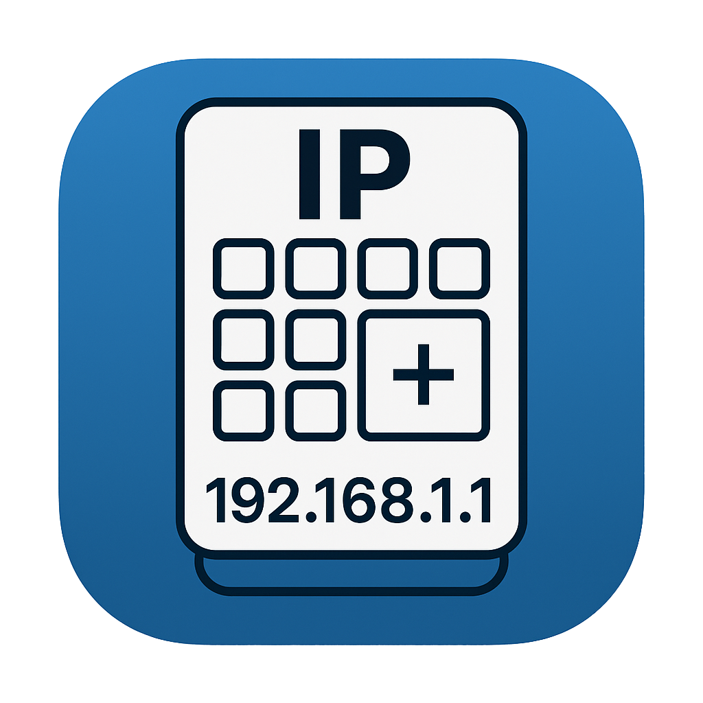

# NetBits

An IP address and subnet calculator for iOS.

<p align="center">
  
</p>

## Features

- Calculate from an IP address and subnet mask/prefix
- CIDR notation input in a single field (`192.168.1.10/24`)
- Binary representation of the address and mask
- Network class (A–E) and address type: Private, Public, Loopback, CGNAT,
  Multicast and more
- Split a network into subnets: into equal parts by choosing a subnet mask,
  or by host counts (VLSM) — enter how many hosts each network needs
- Copy any result value with a long press
- Share the result or the list of subnets as text
- Light and Dark mode
- Localization: English, Русский

## What it calculates

Netmask, wildcard, network and broadcast address, usable host range, host
count, network class and address type — plus the binary view of the address
and mask.

Split network:

- **Equal parts** — pick a subnet mask and get every subnet with its host
  count, host range and broadcast address.
- **By hosts** — list the networks you need; the largest are placed first, each
  gets the smallest subnet that fits, and the free remainder is shown. If the
  networks don't fit, NetBits says which one.

## Requirements

- iOS 15.6+
- Xcode 16+

## Build

```bash
open IPCalculator.xcodeproj
```

or from the terminal:

```bash
xcodebuild -project IPCalculator.xcodeproj -scheme IPCalculator \
  -destination 'platform=iOS Simulator,name=iPhone 16' build
```

## Architecture

MVP: the `Presenter` owns business logic and screen state, the
`View`/`ViewController` only render, `Service`/`Formatter`/`Validator` handle
IP calculation and validation.

Branches: `feature/*` → `develop` (rebase, no merge commits) → `master` via
Pull Request.
